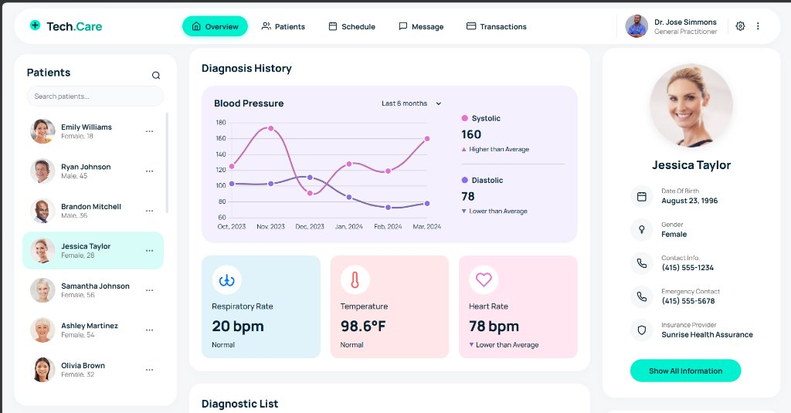

# 🩺 Tech.Care — Patient Medical Dashboard

> An interactive, responsive healthcare dashboard designed for medical practitioners to monitor patient health records, vital signs, diagnostic history, and longitudinal blood pressure trends in real-time.

---

## 📸 Screenshots


*Tech.Care full patient overview featuring diagnosis analytics, vitals, patient profile, and lab results.*

---

## ✨ Key Features

- **📊 Interactive Blood Pressure Analytics:**
  - Real-time smooth spline multi-line chart powered by **Chart.js**.
  - Dynamic timeframe filter (Last 6 Months, Last 12 Months, All History).
  - Systolic and Diastolic summary metrics with comparative indicator badges (*Higher than Average*, *Normal*, *Lower than Average*).

- **🫀 Live Vitals Monitoring:**
  - Dedicated cards for **Respiratory Rate**, **Temperature**, and **Heart Rate**.
  - Color-coded thresholds and visual trend arrows.

- **📋 Diagnostic History & Treatment Status:**
  - Structured, responsive table showing conditions, descriptions, and clinical statuses (e.g., *Under Observation*, *Active*, *Resolved*).

- **👤 Comprehensive Patient Profile:**
  - Displays patient demographics: Date of Birth, Gender, Emergency Contact, and Insurance Provider.
  - Quick action buttons to view full profile details.

- **🧪 Lab Results Section:**
  - Clean listing of downloadable clinical lab test records.

- **🔍 Patient Directory with Live Search:**
  - Left sidebar listing all clinic patients with instant text filtering.

- **📱 Fully Responsive Design:**
  - Custom CSS Grid & Flexbox layout styled with modern typography (**Manrope** font) and soft healthcare palette.

---

## 🛠️ Tech Stack

| Technology | Role |
| :--- | :--- |
| **HTML5 & CSS3** | Semantic structure, responsive layouts (Grid & Flexbox), and custom styling |
| **Vanilla JavaScript (ES6+)** | Dynamic DOM manipulation, API client, search filtering, and state handling |
| **Chart.js** | Multi-dataset spline curves, custom tooltips, and canvas rendering |
| **Node.js (Built-in `http`)** | Lightweight zero-dependency local static file server |
| **Healthcare REST API** | Authenticated RESTful patient health data endpoint |

---

## 🚀 Getting Started

Follow these instructions to run the project locally on your machine.

### Prerequisites

Ensure you have [Node.js](https://nodejs.org/) installed on your system:
```bash
node -v
```

### 1. Clone the Repository
```bash
git clone https://github.com/YOUR_USERNAME/tech-care-dashboard.git
cd tech-care-dashboard
```

### 2. Start the Local Server
This project includes a built-in zero-dependency Node.js server. Run:
```bash
npm start
```
*Or directly with Node:*
```bash
node server.js
```

### 3. Open in Browser
Open your favorite browser and visit:
```
http://localhost:8080
```

> **Note:** The dashboard will automatically fetch and display patient records (defaults to **Jessica Taylor** as required by the technical specification).

---

## 📂 Project Structure

```text
p-dashboard/
├── index.html        # Main dashboard semantic layout
├── style.css         # Modern responsive CSS styling & theme variables
├── app.js            # API fetch, Chart.js configuration & state management
├── server.js         # Built-in lightweight Node.js HTTP server
├── package.json      # Project metadata & npm scripts
├── screenshots/      # Dashboard preview image (dashboard-preview.jpg)
└── README.md         # Project documentation
```

---

## 🎨 Design & Attribution

- UI & layout inspired by modern clinical management dashboard specifications.
- Typography: [Google Fonts — Manrope](https://fonts.google.com/specimen/Manrope)
- Icons: Semantic lightweight SVG icons.

---

## 📄 License

This project is licensed under the [ISC License](LICENSE).

